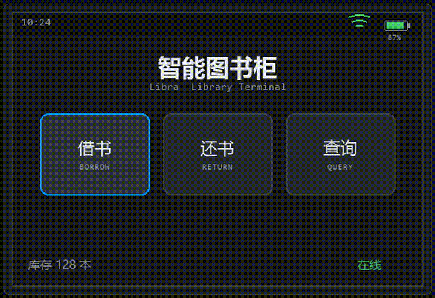

# Libra · ESP32-S3 智能图书柜终端

面向校园图书借阅的智能终端。ESP32-S3 单芯片承载**人脸核验 + LVGL 触摸界面 + 语音提示 + 云端同步**四路交互。

> 本项目为公司产品项目的架构与设计说明。受保密约束，完整固件源码未公开，仓库内提供任务框架、字库裁剪工具与关键模块设计说明。



*480×320 触摸屏完整借书流程：主页 → 对准摄像头 → 人脸核验（扫描线 + 进度）→ 验证通过 → 借阅信息。*

---

## 核心指标

| 指标 | 数值 |
|---|---|
| 人脸核验耗时 | 平均 < 400ms |
| 人脸库规模 / 误识率 | 20 人库，误识率 < 3% |
| 界面帧率 | 稳定 30fps |
| 场景切换耗时 | < 40ms |
| 语音响应 | < 100ms |
| 字库体积优化 | 数 MB → 几十 KB |
| 人脸库持久化 | Flash 存储，断电不丢 |

## 硬件配置

| 部件 | 型号 | 接口 |
|---|---|---|
| 主控 | ESP32-S3（Xtensa LX7 双核 240MHz，8MB PSRAM） | — |
| 摄像头 | OV2640 | DVP |
| 显示屏 | SPI LCD + 电容触摸 | SPI / I2C |
| 音频采集 | ES7210 | I2S |
| 音频输出 | ES8311 | I2S |
| IO 扩展 | PCA9557 | I2C |
| 环境 | 光敏 + 温湿度 | ADC / I2C |

## 软件架构

按**感知 → 识别 → 交互 → 上云**四层组织，每层独立成任务：

```
┌──────────────────────────────────────────────────┐
│                    Application                    │
├──────────┬──────────┬──────────┬─────────────────┤
│  TaskCam │ TaskRec  │ TaskUI   │ TaskCloud       │
│  抓拍    │ 人脸核验  │ LVGL渲染 │ MQTT 同步        │
│  core1   │  core1   │  core0   │  core0          │
├──────────┴──────────┴──────────┴─────────────────┤
│  TaskVoice（I2S 播放队列）  TaskEnv（环境监测）    │
├──────────────────────────────────────────────────┤
│         FreeRTOS  /  ESP-IDF 5.x                 │
└──────────────────────────────────────────────────┘
```

### 双核绑核策略

```c
xTaskCreatePinnedToCore(task_camera,  "cam",   4096, NULL, 6, NULL, 1);
xTaskCreatePinnedToCore(task_recognize,"rec",  8192, NULL, 5, NULL, 1);
xTaskCreatePinnedToCore(task_ui,       "ui",   8192, NULL, 4, NULL, 0);
xTaskCreatePinnedToCore(task_cloud,    "cloud",4096, NULL, 3, NULL, 0);
xTaskCreatePinnedToCore(task_voice,    "voice",4096, NULL, 2, NULL, 0);
```

**摄像头采集与 AI 推理绑 core1，LCD 与 LVGL 绑 core0。** 推理占用 core1 时，core0 的界面刷新完全不受影响，这是帧率稳定 30fps 的前提。

### 任务间通信

| 通道 | 类型 | 用途 |
|---|---|---|
| `q_frame` | 队列（深度 2） | 摄像头 → 识别，传帧指针 |
| `q_preview` | 队列（深度 2） | 识别 → LCD，抓拍预览 |
| `q_voice` | 队列（深度 8） | 事件 → 语音，投递 PCM 播放请求 |
| `sem_verified` | 二值信号量 | 核验通过 → 放行借阅流程 |
| `mtx_nvs` | 互斥量 | 保护人脸库 Flash 读写 |

任一模块阻塞不影响其他模块：识别超时不返回，界面照样响应触摸。

## 人脸核验流程

```
TaskCam  ──帧──► q_frame ──► TaskRec
                                │
                                ├─ human_face_detect()      检测
                                ├─ 特征提取
                                ├─ 1:N 比对（人脸库在 Flash）
                                │
                                ├─ 命中 ──► xSemaphoreGive(sem_verified)
                                │            └─► 放行借阅 + q_voice 播报
                                └─ 未命中 ─► 界面提示 + 重新采集
```

人脸 ID 用 `set_ids_from_flash` 持久化，断电不丢；支持云端下行指令**增量更新人脸库**，不必返场刷机。

## LVGL 界面优化

四个界面：主页、借书、还书、查询。

- **子页面预创建**，切换只做 `lv_scr_load`，实测 < 40ms
- **字库裁剪**：`lv_font_conv` 生成 16/24px、1bpp 中文子集字库，从数 MB 压到几十 KB，为 Flash 省出 2MB+
- 双缓冲防撕裂，`disp_drv.full_refresh = 0` 配合局部刷新

字库裁剪脚本见 [`tools/font_subset.md`](tools/font_subset.md)。

## 语音链路

```
I2S DMA ──► ES7210 采集 ──► ESP-Skainet 命令词识别 ──► 业务事件
ES8311 播放 ◄── I2S DMA ◄── PCM 资源 ◄── q_voice 播放队列
```

提示音做成 PCM 资源按事件异步播放，DMA 搬运全程不占 CPU，响应 < 100ms。

## 目录结构

```
libra-smart-library/
├── docs/
│   ├── architecture.md      四层架构与任务通信
│   ├── face-pipeline.md     人脸核验流水线与性能调优
│   └── bringup-log.md       板级 bring-up 与外设调试记录
├── framework/               任务框架参考实现
│   ├── task_binding.c       双核绑核与任务创建模板
│   ├── task_binding.h
│   └── queue_io.h           任务间队列/信号量封装
└── tools/
    └── font_subset.md       lv_font_conv 字库裁剪命令与参数
```

## 开发环境

- ESP-IDF v5.x
- `idf.py set-target esp32s3`
- 组件：`esp-who`、`esp-skainet`、`esp_lvgl_port`、`esp32-camera`

```bash
idf.py menuconfig     # PSRAM 选 Octal，Flash 8MB，分区表 custom
idf.py build flash monitor
```

## 踩坑记录

| 现象 | 根因 | 解法 |
|---|---|---|
| 识别时界面卡顿 | 推理与 UI 同核，抢占 | 绑核分离，推理 core1 / UI core0 |
| 字库烧不进 Flash | 字库过大超出分区 | lv_font_conv 裁剪为 1bpp 子集 |
| 抓拍帧花屏 | 帧缓冲复用冲突 | 帧队列深度 2 + 引用计数 |
| 语音播放爆音 | 逐字节拷贝打断 DMA | 改为 PCM 资源整体投递 |

## License

MIT（仅限本仓库内文档与参考实现）
